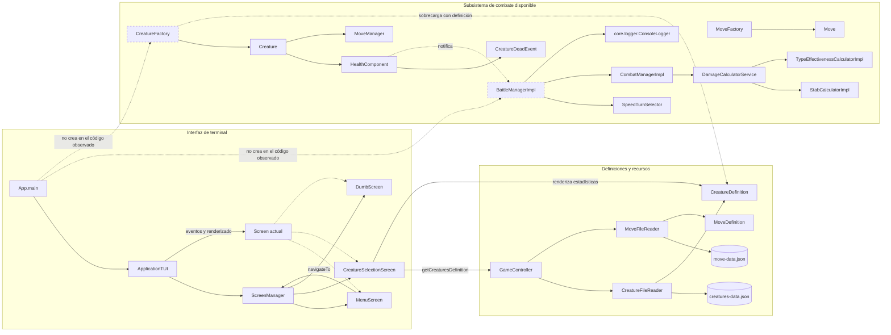
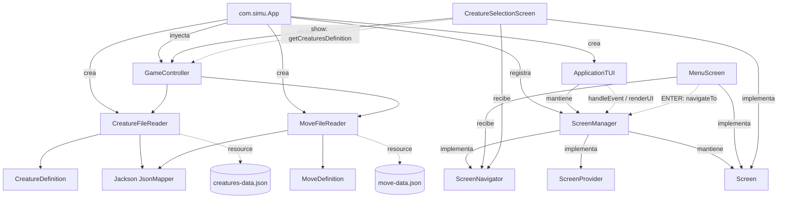
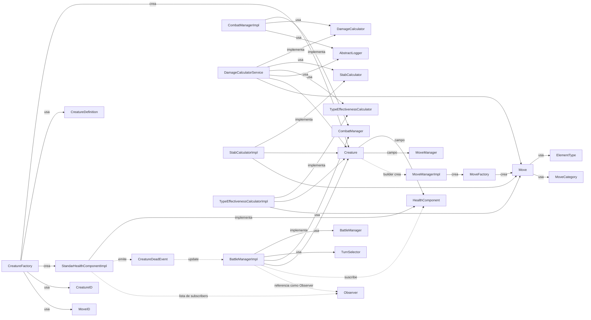
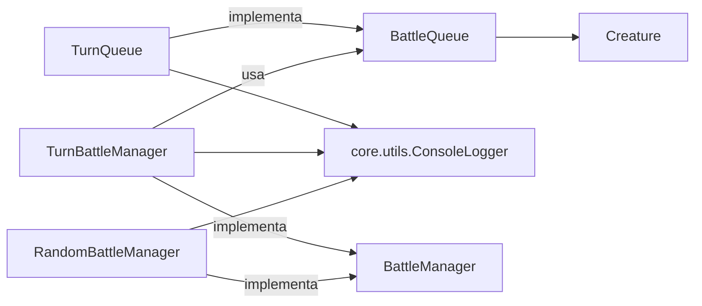
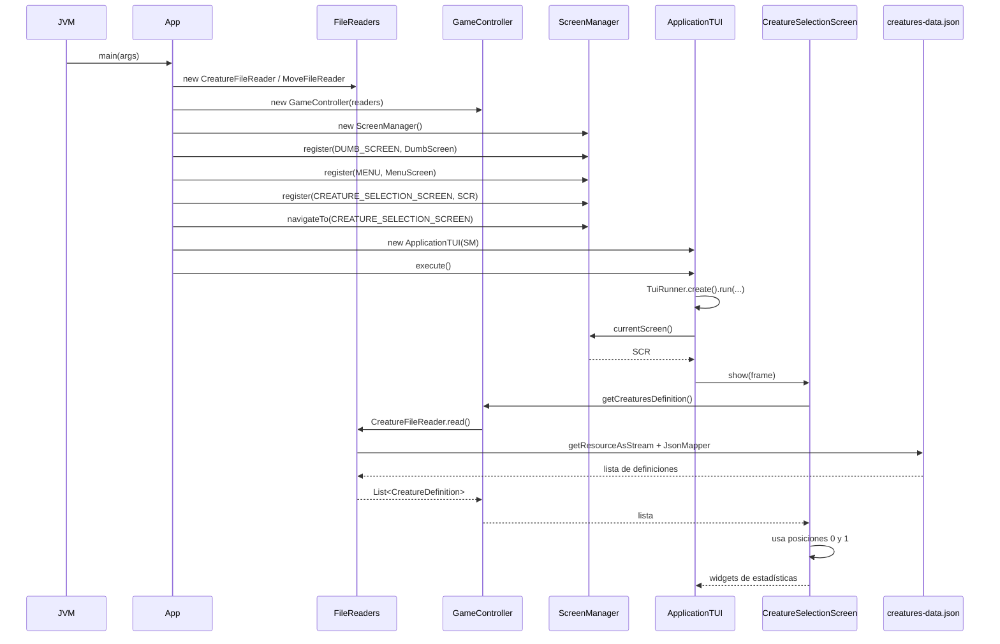
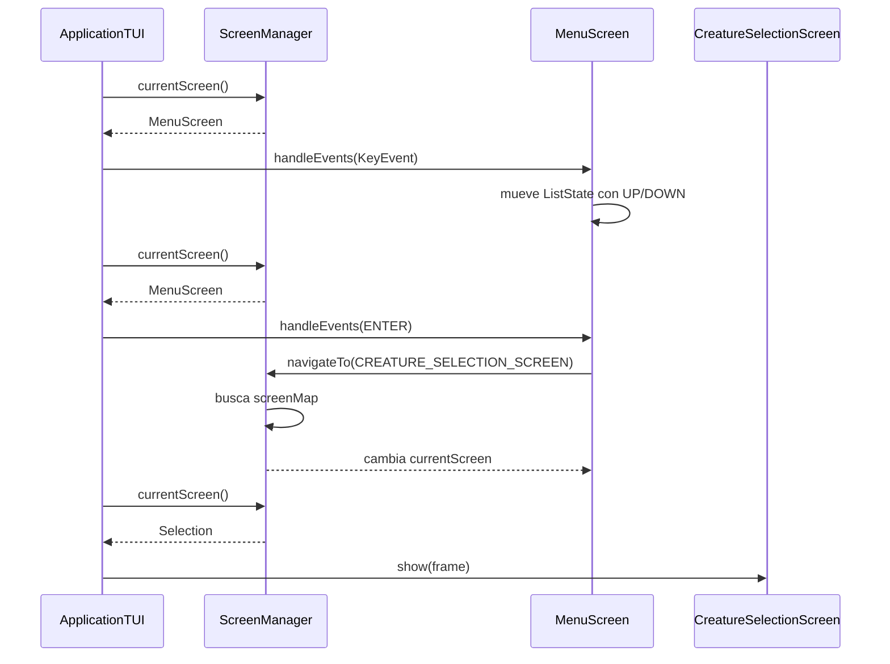
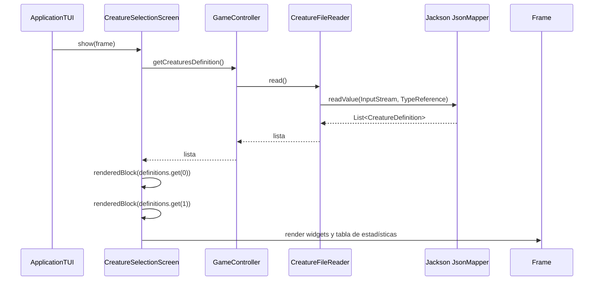
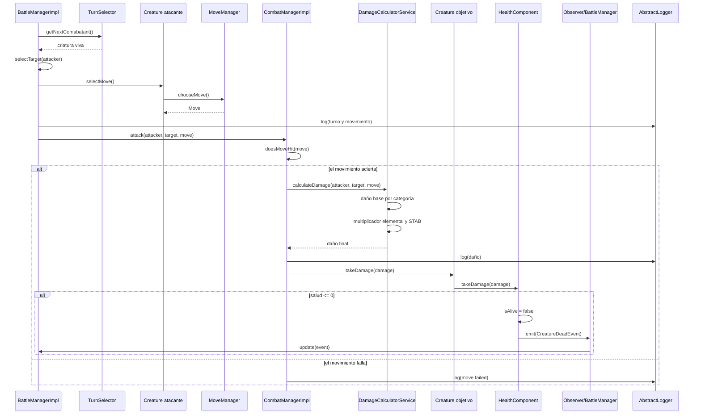
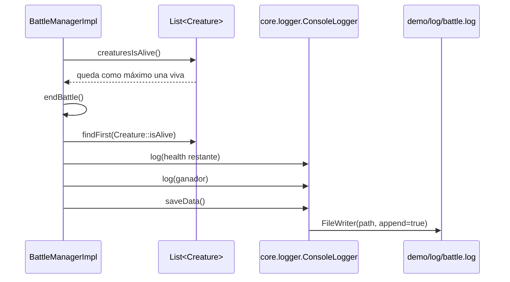

# Auditoría arquitectónica descriptiva

## 0. Alcance, método y límites

Este documento describe el estado observable del repositorio a partir de:

- `demo/pom.xml`.
- Las clases Java bajo `demo/src/main/java`.
- La prueba bajo `demo/src/test/java`.
- Los recursos bajo `demo/src/main/resources` y los archivos de datos del directorio raíz.
- `README.md`, cuyo contenido actual es únicamente `-- README.MD--`.

Las referencias de evidencia usan la forma `ruta:líneas`. Las conclusiones se clasifican como:

- **Confirmado:** se observa directamente en el código o en la configuración.
- **Inferido:** se deduce del encadenamiento de llamadas y de la construcción de objetos, pero no se comprobó ejecutando ese escenario.
- **Pendiente de verificación:** el código permite identificar una posibilidad, pero falta observar el comportamiento de la biblioteca externa, del entorno o de un flujo no conectado.

La revisión es estática. No se ejecutó la aplicación ni una compilación adicional, para conservar la restricción de no modificar archivos existentes. El archivo generado por esta auditoría es el único artefacto nuevo.

## 1. Resumen ejecutivo del estado actual

El repositorio contiene una aplicación Java 21 con una interfaz de terminal basada en TamboUI y un subsistema de combate por turnos en evolución. Ambos grupos de código comparten entidades y contratos, pero el punto de entrada principal no conecta actualmente la interfaz con el combate.

El recorrido que sí está conectado es:

1. `com.simu.App.main` crea lectores de recursos y un `GameController`.
2. Registra tres pantallas en `ScreenManager`.
3. Selecciona inicialmente `CreatureSelectionScreen`.
4. `ApplicationTUI` entrega eventos y cuadros de renderizado a la pantalla actual.
5. `CreatureSelectionScreen.show` pide las definiciones de criaturas al controlador y muestra las dos primeras.

El recorrido de combate disponible en el código es independiente del anterior:

1. `CreatureFactory` puede crear `Creature` con salud, atributos y movimientos hardcodeados.
2. `BattleManagerImpl` puede coordinar turnos mediante un `TurnSelector`.
3. `CombatManagerImpl` delega el cálculo a `DamageCalculatorService`.
4. La salud emite `CreatureDeadEvent` cuando llega a cero.
5. `BattleManagerImpl` recibe ese evento, pero su método `update` no modifica el estado de batalla.

No se observa en `App`, `GameController` ni en las pantallas una creación de `CreatureFactory`, `BattleManagerImpl`, `CombatManagerImpl`, `DamageCalculatorService` o `SpeedTurnSelector`. Por tanto, el combate no forma parte del flujo de inicio comprobable por lectura del punto de entrada.

## 2. Estructura general

### 2.1 Módulo y dependencias externas

El proyecto Maven está concentrado en `demo/` (`demo/pom.xml`). El proyecto declara:

- Java `release 21` (`demo/pom.xml:15-17`).
- TamboUI Toolkit, administrado mediante `tamboui-bom` versión `0.5.0` (`demo/pom.xml:20-33`).
- Backend JLine 3 de TamboUI (`demo/pom.xml:35-39`).
- Jackson Databind 3.2.4 (`demo/pom.xml:41-46`).
- JUnit 4.11 con alcance de prueba (`demo/pom.xml:48-53`).

No hay otro módulo Maven ni una capa de persistencia de base de datos. La persistencia presente consiste en lectura de recursos empaquetados y escritura de un archivo de log desde `com.simu.core.logger.ConsoleLogger`.

### 2.2 Punto de entrada y composición

`com.simu.App` funciona como composición manual de dependencias:

- Crea `CreatureFileReader` y `MoveFileReader` (`demo/src/main/java/com/simu/App.java:25-30`).
- Los inyecta en `GameController` (`App.java:30`).
- Crea `ScreenManager` y registra `DumbScreen`, `MenuScreen` y `CreatureSelectionScreen` (`App.java:33-37`).
- Selecciona `CREATURE_SELECTION_SCREEN` (`App.java:39-41`).
- Crea `ApplicationTUI` y ejecuta su bucle (`App.java:44-52`).

La clase también contiene imports y variables no utilizados (`Screen`, `HashMap` y `Map`), pero la responsabilidad arquitectónica relevante es que concentra toda la composición de la interfaz y de la lectura de datos.

Existe un segundo punto de entrada, `com.simu.tui.RunTuiApp` (`demo/src/main/java/com/simu/tui/RunTuiApp.java:8-25`). Ese punto crea un `ScreenManager` vacío, no registra pantallas y no llama a `navigateTo`; por ello, su uso queda separado del arranque configurado por `App`.

### 2.3 Interfaz de usuario de terminal

#### `ApplicationTUI`

`ApplicationTUI` adapta `TuiRunner` a la interfaz propia `Application` (`demo/src/main/java/com/simu/tui/ApplicationTUI.java:10-57`). Mantiene una referencia a `ScreenManager` y:

- Reenvía cada evento no asociado a salir a `screenManager.currentScreen().handleEvents(event)` (`ApplicationTUI.java:18-20, 47-53`).
- Reenvía cada renderizado a `screenManager.currentScreen().show(frame)` (`ApplicationTUI.java:31-33, 54`).
- Intercepta la tecla de salida mediante `KeyEvent.isQuit()` (`ApplicationTUI.java:47-51`).

No contiene lógica de dominio ni conoce criaturas, movimientos o combate.

#### `ScreenManager` y contratos de pantalla

`ScreenManager` implementa `ScreenNavigator` y `ScreenProvider` (`demo/src/main/java/com/simu/tui/screen/ScreenManager.java:9-53`). Mantiene:

- `currentScreen`, la pantalla que recibe eventos y renderiza.
- `screenMap`, un registro de `ScreenType` a `Screen`.

`Screen` define `handleEvents` y `show` (`demo/src/main/java/com/simu/abstracts/Screen.java:7-12`). `ScreenNavigator` solo expone `navigateTo` (`demo/src/main/java/com/simu/tui/screen/ScreenNavigator.java:5-8`) y `ScreenProvider` solo expone `currentScreen` (`demo/src/main/java/com/simu/tui/screen/ScreenProvider.java:5-7`).

La selección de pantalla se hace por instancia previamente registrada. Si la clave no existe, `navigateTo` asigna un `DumbScreen` (`ScreenManager.java:20-24`). El constructor no establece una pantalla inicial (`ScreenManager.java:14-17`).

#### Pantallas

- `MenuScreen` mantiene el estado de selección de la lista y conoce un `ScreenNavigator` (`demo/src/main/java/com/simu/tui/screen/MenuScreen.java:28-54`). Las teclas arriba y abajo cambian el índice; `ENTER` solo implementa la ruta `IA vs IA`, que navega a `CREATURE_SELECTION_SCREEN` (`MenuScreen.java:58-77, 136-144`). Las demás opciones se muestran, pero no tienen una transición implementada.
- `CreatureSelectionScreen` conoce un `ScreenNavigator`, un `GameController` y un `TableState` (`demo/src/main/java/com/simu/tui/screen/CreatureSelectionScreen.java:28-40`). Su `handleEvents` siempre devuelve `false` (`CreatureSelectionScreen.java:42-47`). Su `show` obtiene las definiciones y renderiza exactamente las posiciones `0` y `1` (`CreatureSelectionScreen.java:50-64`).
- `DumbScreen` es una pantalla de fallback visual y no procesa eventos (`demo/src/main/java/com/simu/tui/screen/DumbScreen.java:14-48`).

La interfaz usa directamente tipos de TamboUI en contratos (`Screen`), aplicación (`ApplicationTUI`) y pantallas. La frontera de presentación no está abstraída respecto del toolkit.

### 2.4 Control y lectura de definiciones

`GameController` es un coordinador pequeño que mantiene un `CreatureFileReader` y un `MoveFileReader` (`demo/src/main/java/com/simu/controller/GameController.java:12-20`).

- `getCreaturesDefinition` llama a `CreatureFileReader.read`, captura `IOException`, escribe un mensaje en consola y devuelve una lista vacía en caso de error (`GameController.java:23-31`).
- `getMovesDefinition` delega la lectura y propaga `IOException` (`GameController.java:33-35`).

Los lectores usan `JsonMapper` y `ClassLoader.getResourceAsStream`:

- `CreatureFileReader` lee `data/creatures-data.json` y produce `List<CreatureDefinition>` (`demo/src/main/java/com/simu/definition/CreatureFileReader.java:10-37`).
- `MoveFileReader` lee `data/move-data.json` y produce `List<MoveDefinition>` (`demo/src/main/java/com/simu/definition/MoveFileReader.java:10-36`).

`CreatureDefinition` y `MoveDefinition` son records de datos (`demo/src/main/java/com/simu/definition/CreatureDefinition.java:5-14` y `MoveDefinition.java:5-14`). No contienen comportamiento de combate.

### 2.5 Entidades y construcción del dominio

`Creature` es la entidad central del combate (`demo/src/main/java/com/simu/core/entity/creature/Creature.java:16-43`). Contiene:

- Identidad y atributos numéricos.
- Una referencia a `HealthComponent`.
- Tipos elementales.
- Un `MoveManager`.
- Métodos de selección de movimiento, daño, consulta y mutación.
- Un método de salida por consola, `creatureDataView` (`Creature.java:62-93`).
- Un método de conexión de observadores a componentes de salud (`Creature.java:172-177`).

Su `Builder` crea el `MoveManagerImpl` cuando recibe `MoveID...` (`Creature.java:346-417`). La entidad puede recibir una lista de movimientos posteriormente con `setMoves` (`Creature.java:324-331`).

`Move` encapsula nombre, potencia, categoría, PP, precisión y tipo (`demo/src/main/java/com/simu/core/entity/move/Move.java:6-26`). El consumo de PP muta el movimiento (`Move.java:31-37`). `MoveManagerImpl` mantiene la lista y elige un movimiento aleatorio (`demo/src/main/java/com/simu/core/entity/move/MoveManagerImpl.java:10-61`).

Hay dos formas de construir criaturas en `CreatureFactory`:

- Desde `CreatureID`, con datos y movimientos hardcodeados (`demo/src/main/java/com/simu/core/factory/CreatureFactory.java:13-93`).
- Desde `CreatureDefinition`, con estadísticas y tipos leídos, pero sin configurar movimientos (`CreatureFactory.java:95-109`).

`MoveFactory` es otra fuente hardcodeada de especificaciones de movimientos (`demo/src/main/java/com/simu/core/factory/MoveFactory.java:8-168`).

### 2.6 Combate y servicios de dominio

El subsistema conectado internamente por contratos está formado por:

- `BattleManager`: interfaz de inicio y fin de batalla (`demo/src/main/java/com/simu/core/contracts/BattleManager.java:3-8`).
- `BattleManagerImpl`: orquestador de turnos, selección de objetivo, suscripción a salud y cierre de combate (`demo/src/main/java/com/simu/core/combat/battle/BattleManagerImpl.java:18-131`).
- `CombatManagerImpl`: resolución de un ataque, comprobación de precisión, cálculo delegado y aplicación de daño (`demo/src/main/java/com/simu/core/combat/battle/CombatManagerImpl.java:11-41`).
- `TurnSelector` y `SpeedTurnSelector`: selección por velocidad y descarte de criaturas no vivas (`demo/src/main/java/com/simu/core/turn/TurnSelector.java:3-8` y `SpeedTurnSelector.java:11-101`).
- `DamageCalculatorService`: daño base por categoría, multiplicador de tipo y STAB (`demo/src/main/java/com/simu/core/service/DamageCalculatorService.java:11-62`).
- `StabCalculatorImpl` y `TypeEffectivenessCalculatorImpl`: cálculos especializados (`demo/src/main/java/com/simu/core/service/StabCalculatorImpl.java:9-24` y `TypeEffectivenessCalculatorImpl.java:8-21`).
- `StandarHealthComponentImpl`: estado de salud, daño y emisión de muerte (`demo/src/main/java/com/simu/core/combat/component/health/StandarHealthComponentImpl.java:11-90`).
- `ElementType`: tabla de efectividad hardcodeada (`demo/src/main/java/com/simu/core/enums/ElementType.java:3-68`).

También existen una segunda cola y dos gestores alternativos:

- `TurnQueue` implementa `BattleQueue` y mantiene su propio orden, ronda y logger (`demo/src/main/java/com/simu/core/combat/queue/TurnQueue.java:10-114`).
- `TurnBattleManager` depende de `BattleQueue` y del logger singleton antiguo, pero su lógica de inicio está comentada y `startBattle` no ejecuta operaciones (`demo/src/main/java/com/simu/core/combat/battle/TurnBattleManager.java:8-102`).
- `RandomBattleManager` conserva una variante de batalla aleatoria comentada; sus métodos activos no inicializan combatientes (`demo/src/main/java/com/simu/core/combat/battle/RandomBattleManager.java:7-80`).

### 2.7 Eventos y observadores

El mecanismo es una relación directa publisher-observer:

- `Publisher` define suscripción y cancelación (`demo/src/main/java/com/simu/core/event/Publisher.java:3-8`).
- `CommandPublisher` agrega `emit(Event)` (`CommandPublisher.java:3-7`).
- `HealthComponent` extiende `CommandPublisher` (`demo/src/main/java/com/simu/core/combat/component/health/HealthComponent.java:3-17`).
- `StandarHealthComponentImpl` mantiene una lista de `Observer`, la recorre al emitir y entrega un `CreatureDeadEvent` (`StandarHealthComponentImpl.java:17, 31-42, 65-90`).
- `BattleManagerImpl` implementa `Observer` y se registra en el componente de salud de cada criatura al construirse (`BattleManagerImpl.java:18, 28-39`).

`CreatureDeadEvent` no contiene datos, aunque importa `Creature` (`demo/src/main/java/com/simu/core/event/event/CreatureDeadEvent.java:3-10`). `BattleManagerImpl.update` reconoce el tipo, pero el cuerpo no cambia estado (`BattleManagerImpl.java:122-128`).

`EventPusblisher` y `EventLogger` existen, pero no aparecen usados por otras clases (`demo/src/main/java/com/simu/core/event/EventPusblisher.java:3-4` y `demo/src/main/java/com/simu/core/dao/EventLogger.java:5-9`).

### 2.8 Logging

Existen dos clases distintas llamadas `ConsoleLogger`:

- `com.simu.core.logger.ConsoleLogger` implementa `AbstractLogger`, conserva historial, escribe en consola y guarda en `demo/log/battle.log` (`demo/src/main/java/com/simu/core/logger/ConsoleLogger.java:15-69`). Es usada por el subsistema nuevo mediante `AbstractLogger`.
- `com.simu.core.utils.ConsoleLogger` es singleton, escribe mensajes directamente a consola y es usada por `TurnQueue`, `TurnBattleManager` y `RandomBattleManager` (`demo/src/main/java/com/simu/core/utils/ConsoleLogger.java:5-40`).

El nombre coincidente no implica que sean intercambiables: pertenecen a paquetes diferentes y tienen APIs diferentes.

## 3. Diagrama de componentes

El siguiente diagrama separa el recorrido de interfaz y datos que sí se compone en `App` del subsistema de combate que está presente pero no se instancia desde ese punto de entrada.

Hecho verificable: `App` registra `CreatureSelectionScreen`, que usa `GameController`; no registra ni crea las clases del subgrafo de combate (`App.java:25-48`, `CreatureSelectionScreen.java:37-64`, `BattleManagerImpl.java:28-39`).

## 4. Diagrama de dependencias

### 4.1 Dependencias de composición, interfaz y datos

En este diagrama, las flechas sólidas representan tipos importados, campos, parámetros o instanciación directa. Las flechas punteadas representan llamadas o interacciones de ejecución relevantes.

La navegación produce un ciclo de referencias de objetos en tiempo de ejecución: `ScreenManager` mantiene las pantallas registradas; `MenuScreen` mantiene el `ScreenNavigator` que en `App` es el mismo `ScreenManager` (`App.java:34-37`, `MenuScreen.java:33,45-46`). No es un ciclo de importaciones directas porque `MenuScreen` depende de la interfaz `ScreenNavigator`, no de la clase concreta `ScreenManager`.

### 4.2 Dependencias del subsistema de combate

La relación `BattleManagerImpl -> HealthComponent -> Observer -> BattleManagerImpl` es un ciclo de interacción en tiempo de ejecución: el gestor se registra en la salud y la salud lo notifica. El evento no contiene referencia a la criatura que murió (`CreatureDeadEvent.java:6-10`), y el receptor no usa el evento para alterar el estado (`BattleManagerImpl.java:122-128`).

### 4.3 Cola y gestores alternativos

La existencia de `SpeedTurnSelector` junto con `TurnQueue`, y de `BattleManagerImpl` junto con `TurnBattleManager` y `RandomBattleManager`, muestra dos líneas de implementación del combate. En las dos clases alternativas, la mayor parte de la operación está comentada (`TurnBattleManager.java:20-84`, `RandomBattleManager.java:18-67`).

### 4.4 Ciclos comprobados y no comprobados

- **Ciclo directo de importaciones Java:** no se identificó uno en el conjunto de imports revisado. Las clases se conectan mediante interfaces y tipos compartidos, pero no se observa una cadena de imports que regrese a su origen.
- **Ciclo de objetos de UI:** confirmado por composición: `ScreenManager` registra una pantalla y `MenuScreen` conserva el navegador que apunta al mismo manager (`App.java:34-37`, `MenuScreen.java:33,45-46`).
- **Ciclo de notificación de combate:** confirmado por el registro de `BattleManagerImpl` como observador de cada salud y la lista de observadores en `StandarHealthComponentImpl` (`BattleManagerImpl.java:34-39`, `StandarHealthComponentImpl.java:17,65-89`).
- **Ciclo entre datos JSON y entidades:** no confirmado. Existen lectores y una sobrecarga de `CreatureFactory`, pero no hay llamadas desde `GameController` hacia `CreatureFactory` en el código observado.

## 5. Flujo de ejecución

### 5.1 Inicio y primer renderizado de `App`

Hechos relevantes del flujo:

- La pantalla inicial no es el menú: `App` selecciona directamente `CREATURE_SELECTION_SCREEN` (`App.java:39-41`).
- La lectura de criaturas se hace durante `show`, no durante la composición ni en una inicialización de estado (`CreatureSelectionScreen.java:50-64`).
- El `show` obtiene la lista y accede a dos posiciones fijas (`CreatureSelectionScreen.java:61-64`).
- Si el lector falla, `GameController` devuelve una lista vacía (`GameController.java:23-29`); a partir de ahí, el acceso a las posiciones esperadas queda expuesto a una excepción por datos insuficientes. Esta última consecuencia es una inferencia directa del código, no una observación de ejecución.

### 5.2 Bucle de eventos y navegación de menú

Este flujo está implementado, pero no es la ruta inicial de `App`.

Solo la opción textual `IA vs IA` llama a `navigateTo`; `Player vs IA`, `Player vs Player`, `Options` y `Exit` no producen una transición en `optionSelecterList` (`MenuScreen.java:136-144`). La tecla de salida se procesa antes de la pantalla, dentro del callback de `TuiRunner` (`ApplicationTUI.java:47-52`).

### 5.3 Selección y renderizado de criaturas

`renderedBlock` divide cada mitad en una zona de imagen y otra de estadísticas. La zona de imagen muestra texto de disponibilidad, y la tabla utiliza HP, ataque, defensa, ataque especial, defensa especial y velocidad (`CreatureSelectionScreen.java:91-184`). No se muestra una imagen ni se inicia una criatura de combate.

### 5.4 Resolución de un turno de combate disponible

Este flujo se puede reconstruir a partir de `BattleManagerImpl`, pero no se alcanza desde `App` con las llamadas existentes.

El detalle de cálculo está definido en `DamageCalculatorService.calculateDamage` (`demo/src/main/java/com/simu/core/service/DamageCalculatorService.java:23-61`). El daño físico usa ataque/defensa, el especial usa ataque especial/defensa especial y el daño verdadero usa solo la potencia escalada. El multiplicador elemental multiplica los tipos del objetivo (`TypeEffectivenessCalculatorImpl.java:11-20`) y el STAB revisa los tipos del atacante (`StabCalculatorImpl.java:13-23`).

### 5.5 Cierre y persistencia del resultado del combate

`endBattle` escribe los resultados a través de `AbstractLogger` y llama a `saveData` (`BattleManagerImpl.java:106-119`). El logger concreto usa una ruta relativa y no crea explícitamente el directorio `demo/log` (`core/logger/ConsoleLogger.java:15-19,53-69`). Si la escritura falla, el error se convierte en otro mensaje de consola dentro del logger.

## 6. Ciclo de vida del estado

### 6.1 Estado de la interfaz

| Estado | Se crea en | Se mantiene en | Se modifica por | Propagación |
|---|---|---|---|---|
| Pantalla actual | `ScreenManager()` / `navigateTo` | `ScreenManager.currentScreen` | `navigateTo` desde `App` o `MenuScreen` | `ApplicationTUI` consulta el proveedor en cada evento y renderizado |
| Registro de pantallas | `ScreenManager()` y `App.register` | `ScreenManager.screenMap` | `register` | `navigateTo` resuelve una pantalla por `ScreenType` |
| Índice del menú | `MenuScreen` | `ListState state` | `handleEvents` con UP/DOWN | `ListWidget.render` refleja el índice |
| Estado de tabla | `CreatureSelectionScreen` | `TableState tableState` | No se modifica en el código observado | Se entrega a `renderStatefulWidget` |
| Definiciones de criaturas | Cada llamada a `CreatureFileReader.read` | Variables locales de `GameController`/`show` | El lector no las conserva | La pantalla las transforma en widgets |

El `GameController` mantiene lectores, no una caché de definiciones. Por ello, el recorrido de selección vuelve a leer el recurso cada vez que `show` es invocado (`GameController.java:12-20`, `CreatureSelectionScreen.java:50-64`).

### 6.2 Estado del dominio

| Estado | Propietario directo | Modificadores observados | Consumidores |
|---|---|---|---|
| HP actual | `StandarHealthComponentImpl.currentHealth` | `takeDamage`, `setCurrentHealth` | `Creature.getCurrentHealth`, `BattleManagerImpl.endBattle` |
| Vivo/muerto de salud | `StandarHealthComponentImpl.isAlive` | `takeDamage` cuando HP llega a cero | `HealthComponent.isDead`, `Creature.isAlive`, `SpeedTurnSelector`, `BattleManagerImpl` |
| Movimientos y PP | `MoveManagerImpl.moves` y campos de `Move` | `Creature.Builder`, `setMoves`, `Move.consumePP` | `Creature.selectMove`, daño y presentación de datos |
| Turno | `SpeedTurnSelector.roundCountIndex` | `getNextComabatant` | `BattleManagerImpl.startBattle` |
| Orden alternativo | `TurnQueue.listCreatures`, `currentTurnIndex`, `currentTurn` | `addCreature`, `getNextCombatant` | `TurnBattleManager` |
| Estado de batalla | `BattleManagerImpl.isEndBattle` | Ninguno en código activo | Ninguno; `update` deja la asignación comentada |

`Creature` conserva además los campos `isAlive` y `canFight`, pero sus consultas públicas no dependen de esos campos: `isAlive()` delega en `healthComponent.isDead()` y `isCanFight()` delega en `moveManager.hasUsableMoves()` (`Creature.java:295-301`). Los setters correspondientes existen (`Creature.java:316-322`), pero no participan en la consulta principal del estado.

El nombre `isDead` de `HealthComponent` no coincide con el valor retornado por `StandarHealthComponentImpl.isDead`, que devuelve el campo interno `isAlive` (`HealthComponent.java:11` y `StandarHealthComponentImpl.java:46-49`). La consecuencia arquitectónica observable es que la semántica de vida queda repartida entre nombres opuestos y una delegación indirecta.

### 6.3 Propagación de cambios

La propagación de estado es diferente por subsistema:

- **UI:** `ApplicationTUI` consulta la pantalla actual; la pantalla de selección consulta datos al renderizar. No hay evento de dominio conectado a la TUI.
- **Combate:** `CombatManagerImpl` llama a `Creature.takeDamage`; la criatura delega a `HealthComponent`; el componente actualiza HP y emite un evento síncrono a sus observadores.
- **Turnos:** `BattleManagerImpl` consulta al `TurnSelector` en cada iteración y el selector conserva su índice entre llamadas.
- **Logging:** las clases de combate reciben un logger o usan el singleton antiguo; no existe un observador de UI para mostrar el resultado de los eventos.

## 7. Responsabilidades y acoplamiento observados

Esta sección describe concentraciones y relaciones existentes; no las clasifica automáticamente como incorrectas.

### 7.1 Concentración de responsabilidades

- `App` realiza composición manual de lectores, controlador, registro de pantallas, selección inicial y ejecución (`App.java:21-61`). Es el punto donde se conocen simultáneamente el arranque, la infraestructura de datos y las clases concretas de UI.
- `Creature` combina estado de entidad, delegación de salud, delegación de movimientos, validación de límites, construcción mediante builder, conexión de observadores y salida formateada a consola (`Creature.java:16-177,267-417`).
- `BattleManagerImpl` valida la preparación, selecciona turnos, elige objetivos, selecciona movimientos, escribe logs, determina el ganador y se registra como observador (`BattleManagerImpl.java:28-39,42-119`).
- `DamageCalculatorService` calcula daño y además escribe mensajes de diagnóstico y de combate (`DamageCalculatorService.java:23-50`).
- `StandarHealthComponentImpl` mantiene salud, define la condición de muerte y administra la lista de observadores (`StandarHealthComponentImpl.java:11-90`).

### 7.2 Conocimiento de detalles internos

- `CreatureSelectionScreen` conoce que existen al menos dos definiciones y que debe mostrar las posiciones `0` y `1` (`CreatureSelectionScreen.java:61-64`).
- `Creature` conoce la clase concreta `MoveManagerImpl` para reemplazar su administrador al ejecutar `setMoves` (`Creature.java:324-330`), aunque su campo se declara como `MoveManager`.
- `MoveManagerImpl` conoce la implementación concreta `MoveFactory` (`MoveManagerImpl.java:6-20`), por lo que la elección de movimiento está vinculada al catálogo hardcodeado.
- `CreatureFactory` conoce la implementación concreta `StandarHealthComponentImpl` y todos los `MoveID` concretos (`CreatureFactory.java:4-9,17-86`).
- `BattleManagerImpl` conoce el tipo concreto `CreatureDeadEvent` para interpretar la notificación (`BattleManagerImpl.java:122-127`).

### 7.3 Implementaciones concretas y contratos

Hay contratos para `BattleManager`, `CombatManager`, `DamageCalculator`, `StabCalculator`, `TypeEffectivenessCalculator`, `MoveManager`, `TurnSelector` y `HealthComponent`. Varios consumidores reciben interfaces, pero la composición visible no instancia el grafo de combate.

En cambio, la construcción de criaturas y movimientos usa directamente implementaciones y factories concretos. La sobrecarga basada en `CreatureDefinition` no recibe un `MoveManager` ni una lista de movimientos, mientras que la sobrecarga basada en `CreatureID` sí lo crea mediante `MoveID` (`CreatureFactory.java:13-109`).

### 7.4 Eventos y control de operaciones

El evento de muerte permite que el componente de salud notifique al gestor de batalla, pero no transporta quién murió ni cambia el flujo en `update` (`CreatureDeadEvent.java:6-10`, `BattleManagerImpl.java:122-128`). El cierre real del bucle depende de volver a evaluar `creaturesIsAlive()` en `startBattle` (`BattleManagerImpl.java:51-65,84-98`), no del callback.

Esto deja dos vías de conocimiento del estado de muerte: consulta directa del estado de cada criatura y notificación por evento. En la implementación actual, la primera controla el bucle y la segunda no tiene efecto visible.

### 7.5 Dependencias que afectan la trazabilidad

- El `GameController` oculta el error de lectura de criaturas y entrega una lista vacía (`GameController.java:23-29`), mientras que `CreatureSelectionScreen` asume datos suficientes. La responsabilidad de manejar la ausencia de datos queda dividida entre ambos.
- `App` captura cualquier `Exception` de `app.execute()` y no registra ni propaga el error (`App.java:46-52`). La causa de un fallo del TUI puede quedar sin evidencia desde ese punto de entrada.
- `ConsoleLogger.saveData` mezcla escritura de archivo, historial, consola y manejo de errores (`core/logger/ConsoleLogger.java:43-69`).
- Los dos `ConsoleLogger` se usan en subsistemas distintos, lo que impide tratar el logging como una única dependencia común sin conocer el paquete concreto.

## 8. Recorridos de operaciones representativas

### 8.1 Arranque de la aplicación configurada

1. **Comienzo:** `com.simu.App.main` (`demo/src/main/java/com/simu/App.java:21-22`).
2. **Orden de métodos:** `new CreatureFileReader` -> `new MoveFileReader` -> `new GameController` -> `new ScreenManager` -> tres llamadas a `register` -> `navigateTo(CREATURE_SELECTION_SCREEN)` -> `new ApplicationTUI` -> `Application.execute` (`App.java:25-48`).
3. **Componentes:** `App`, ambos lectores, `GameController`, `ScreenManager`, las tres pantallas y `ApplicationTUI`.
4. **Datos:** las instancias de lectores se conservan dentro de `GameController`; todavía no se lee ningún archivo durante la composición.
5. **Efectos secundarios:** `navigateTo` escribe `Se selecciono la interfaz` en consola (`ScreenManager.java:21-24`); `TuiRunner` toma el control del terminal en `ApplicationTUI.execute` (`ApplicationTUI.java:43-56`).
6. **Fin observable:** el control entra en el bucle de TamboUI. La primera pantalla configurada es `CreatureSelectionScreen`, no el menú.

**Certeza:** confirmado por construcción y llamadas visibles.

### 8.2 Renderizado de la pantalla de selección

1. **Comienzo:** callback `renderUI` de `ApplicationTUI` (`ApplicationTUI.java:31-33,54`).
2. **Orden de métodos:** `ScreenManager.currentScreen` -> `CreatureSelectionScreen.show` -> `GameController.getCreaturesDefinition` -> `CreatureFileReader.read` -> `JsonMapper.readValue` -> `renderedBlock` dos veces -> `createTableStats` dos veces.
3. **Componentes:** TUI, manager, pantalla, controlador, lector, Jackson y recurso JSON.
4. **Datos:** `List<CreatureDefinition>` se transforma en filas de tabla con seis atributos por criatura (`CreatureSelectionScreen.java:163-184`).
5. **Efectos secundarios:** lectura del recurso en cada renderizado y emisión de un mensaje de error por consola si la lectura falla (`GameController.java:26-28`).
6. **Fin observable:** dos bloques visuales con estadísticas; el área superior muestra que la vista de criatura no está disponible (`CreatureSelectionScreen.java:134-153`).

**Certeza:** confirmado en el código. El número mínimo de datos requerido y la excepción resultante ante una lista corta son inferidos.

### 8.3 Navegación `IA vs IA`

1. **Comienzo:** `MenuScreen.handleEvents` recibe un `KeyEvent` (`MenuScreen.java:58-71`).
2. **Orden de métodos:** `state.selected` -> `optionSelecterList` -> `ScreenNavigator.navigateTo(CREATURE_SELECTION_SCREEN)` -> `ScreenManager.navigateTo` -> actualización de `currentScreen`.
3. **Componentes:** `ApplicationTUI`, `ScreenManager`, `MenuScreen`, `ScreenNavigator` y la pantalla seleccionada.
4. **Datos:** se pasa el texto de la opción seleccionada; no se crean criaturas ni se inicia combate.
5. **Efectos secundarios:** cambio del objeto que recibirá eventos y renderizado posterior.
6. **Fin observable:** el siguiente render consulta y muestra `CreatureSelectionScreen`.

**Certeza:** confirmado como flujo implementado. No es el flujo inicial de `App` porque `App` navega directamente a selección.

### 8.4 Creación de una criatura desde una definición

1. **Comienzo:** llamada externa a `CreatureFactory.createCreature(CreatureDefinition)` (`CreatureFactory.java:95`). No hay una llamada a ese método en el punto de entrada observado.
2. **Orden de métodos:** getters del record (`name`, `hp`, `attack`, `defense`, `specialAttack`, `specialDefense`, `speed`, `elementTypes`) -> `new StandarHealthComponentImpl` -> métodos del `Creature.Builder` -> `build` -> constructor privado de `Creature`.
3. **Componentes:** `CreatureFactory`, `CreatureDefinition`, `StandarHealthComponentImpl`, `Creature.Builder` y `Creature`.
4. **Datos:** las estadísticas y los tipos del record se copian a la entidad.
5. **Efectos secundarios:** se crea el componente de salud con HP inicial y se asigna la lista de tipos.
6. **Fin observable:** se devuelve una `Creature` cuyo `moveManager` no se configura dentro de esta sobrecarga; esa ausencia queda visible en `Creature.Builder` y en las líneas 95-109 de la factory.

**Certeza:** confirmado para la construcción del objeto. La consecuencia al intentar seleccionar un movimiento se infiere de `Creature.selectMove` y del campo no inicializado.

### 8.5 Un ataque dentro de `BattleManagerImpl`

1. **Comienzo:** una iteración de `BattleManagerImpl.startBattle` mientras `creaturesIsAlive()` retorna `true` (`BattleManagerImpl.java:75-98`).
2. **Orden de métodos:** `TurnSelector.getNextComabatant` -> `selectTarget` -> `Creature.selectMove` -> `MoveManager.chooseMove` -> `CombatManager.attack` -> `doesMoveHit` -> `DamageCalculator.calculateDamage` -> `Creature.takeDamage` -> `HealthComponent.takeDamage`.
3. **Componentes:** gestor de batalla, selector, criatura atacante, administrador de movimientos, gestor de combate, calculadores, criatura objetivo, salud y logger.
4. **Datos:** se selecciona una criatura viva, un primer objetivo distinto, un movimiento y un número de daño. El cálculo usa categoría, atributos, tipos y STAB.
5. **Efectos secundarios:** consumo de PP en la ruta aleatoria de `MoveManagerImpl.chooseMove`, cambios de HP, logs y posible emisión de `CreatureDeadEvent`.
6. **Fin observable:** el gestor vuelve a evaluar las criaturas vivas; al terminar el bucle llama a `endBattle` y guarda logs.

**Certeza:** secuencia confirmada por llamadas activas. La ejecución completa requiere construir e inyectar todas las dependencias y no está conectada a `App`.

## 9. Hallazgos arquitectónicos

### H1. El punto de entrada de la TUI no conecta el combate

- **Descripción objetiva:** `App` compone lectores, controlador y pantallas, pero no crea `CreatureFactory`, `BattleManagerImpl`, `CombatManagerImpl`, calculadores ni selector de turnos.
- **Evidencia:** `demo/src/main/java/com/simu/App.java:25-48`; clases de combate en `demo/src/main/java/com/simu/core/combat` y `core/service`.
- **Componentes:** `App`, TUI, `GameController`, subsistema de combate.
- **Consecuencia observable/riesgo potencial:** el flujo inicial termina mostrando definiciones; las operaciones de combate solo están disponibles mediante una composición externa no presente en el punto de entrada.
- **Certeza:** **confirmado**.

### H2. Hay dos fuentes de configuración de criaturas y movimientos

- **Descripción objetiva:** existen definiciones JSON, una factory con valores hardcodeados para `CreatureID`, una factory basada en `CreatureDefinition` y una `MoveFactory` con valores hardcodeados.
- **Evidencia:** `demo/src/main/resources/data/creatures-data.json:1-50`, `demo/src/main/resources/data/move-data.json:1-154`, `CreatureFactory.java:13-109`, `MoveFactory.java:10-168`.
- **Componentes:** lectores, records de definición, factories, entidades.
- **Consecuencia observable/riesgo potencial:** el origen de los atributos y movimientos depende del camino de construcción elegido; los datos de pantalla y los datos de una criatura de combate no están necesariamente producidos por la misma fuente.
- **Certeza:** **confirmado**.

### H3. La factory basada en definiciones no configura movimientos

- **Descripción objetiva:** `createCreature(CreatureDefinition)` asigna nombre, salud, atributos, velocidad y tipos, pero no llama a `moveManager(...)` ni a `setMoves(...)`.
- **Evidencia:** `demo/src/main/java/com/simu/core/factory/CreatureFactory.java:95-109`; `Creature.java:43,142-144,324-331`.
- **Componentes:** `CreatureFactory`, `Creature.Builder`, `Creature`, `MoveManager`.
- **Consecuencia observable/riesgo potencial:** una criatura construida exclusivamente por esa ruta conserva el administrador de movimientos sin configurar; las operaciones que requieren `selectMove` o `isCanFight` dependen de ese estado.
- **Certeza:** **confirmado** para la ausencia de configuración; **inferido** para el fallo al ejecutar una operación posterior.

### H4. La pantalla de selección concentra supuestos de datos y acceso a recursos

- **Descripción objetiva:** la pantalla lee definiciones desde el controlador dentro de `show` y usa directamente los índices 0 y 1.
- **Evidencia:** `demo/src/main/java/com/simu/tui/screen/CreatureSelectionScreen.java:50-64`; `GameController.java:23-29`.
- **Componentes:** `CreatureSelectionScreen`, `GameController`, `CreatureFileReader`, JSON de criaturas.
- **Consecuencia observable/riesgo potencial:** cada renderizado vuelve a acceder al recurso y una respuesta vacía o con menos de dos elementos no tiene una representación prevista en la pantalla.
- **Certeza:** **confirmado** para el acceso repetido y los índices fijos; **inferido** para la excepción en caso de lista insuficiente.

### H5. El evento de muerte existe, pero no controla el fin de batalla

- **Descripción objetiva:** salud emite `CreatureDeadEvent`; `BattleManagerImpl` se suscribe y reconoce el evento, pero `update` no modifica `isEndBattle` ni otra condición.
- **Evidencia:** `demo/src/main/java/com/simu/core/combat/component/health/StandarHealthComponentImpl.java:31-42,65-90`; `BattleManagerImpl.java:122-128`.
- **Componentes:** `HealthComponent`, `StandarHealthComponentImpl`, `CreatureDeadEvent`, `BattleManagerImpl`.
- **Consecuencia observable/riesgo potencial:** la notificación y la condición efectiva de terminación son mecanismos distintos; el bucle depende de volver a consultar `creaturesIsAlive`.
- **Certeza:** **confirmado**.

### H6. El estado de vida tiene nombres y fuentes de verdad divergentes

- **Descripción objetiva:** `HealthComponent` expone `isDead`, la implementación devuelve `isAlive`, `Creature.isAlive` delega en ese método y `Creature` también tiene un campo `isAlive` separado que no usa esa consulta.
- **Evidencia:** `demo/src/main/java/com/simu/core/combat/component/health/HealthComponent.java:11-15`; `StandarHealthComponentImpl.java:13-16,46-49`; `Creature.java:45-46,295-301,320-322`.
- **Componentes:** `Creature`, `HealthComponent`, `StandarHealthComponentImpl`.
- **Consecuencia observable/riesgo potencial:** la interpretación de vivo/muerto exige seguir una delegación cuyo nombre no coincide con el valor retornado; los setters de estado no controlan la consulta principal.
- **Certeza:** **confirmado**.

### H7. Existen dos infraestructuras de logging

- **Descripción objetiva:** hay dos clases `ConsoleLogger` con contratos, estado y consumidores distintos.
- **Evidencia:** `demo/src/main/java/com/simu/core/logger/ConsoleLogger.java:15-69`; `demo/src/main/java/com/simu/core/utils/ConsoleLogger.java:5-40`; usos en `TurnQueue.java:3-16` y `CombatManagerImpl.java:3-19`.
- **Componentes:** servicios de combate, gestores alternativos, logger abstracto y singleton.
- **Consecuencia observable/riesgo potencial:** el comportamiento de logging, persistencia y formato depende de la variante concreta y del paquete importado; los dos subsistemas no comparten la misma API.
- **Certeza:** **confirmado**.

### H8. Hay una línea de implementación alternativa parcialmente conservada

- **Descripción objetiva:** `TurnQueue`, `TurnBattleManager` y `RandomBattleManager` contienen una estrategia de cola y gestores diferentes de `SpeedTurnSelector` y `BattleManagerImpl`; la operación principal de los gestores alternativos está comentada o vacía.
- **Evidencia:** `demo/src/main/java/com/simu/core/combat/queue/TurnQueue.java:10-114`; `TurnBattleManager.java:20-102`; `RandomBattleManager.java:18-80`; `SpeedTurnSelector.java:11-101`.
- **Componentes:** contratos `BattleQueue` y `BattleManager`, dos familias de gestores, dos loggers.
- **Consecuencia observable/riesgo potencial:** hay más de un modelo de coordinación de turnos en el código y no se identifica una única implementación activa desde el punto de entrada.
- **Certeza:** **confirmado**.

### H9. El control de errores de inicio puede ocultar fallos del TUI

- **Descripción objetiva:** `App.main` captura cualquier `Exception` durante `app.execute()` y deja vacío el cuerpo del `catch`.
- **Evidencia:** `demo/src/main/java/com/simu/App.java:46-52`.
- **Componentes:** `App`, `ApplicationTUI`, `TuiRunner`.
- **Consecuencia observable/riesgo potencial:** una excepción del bucle de interfaz puede terminar el flujo sin mensaje ni causa visible desde ese punto de entrada.
- **Certeza:** **confirmado**.

### H10. El segundo punto de entrada no completa la composición de pantallas

- **Descripción objetiva:** `RunTuiApp` crea un `ScreenManager` vacío, conserva un `DumbScreen` en una variable no usada, no registra pantallas y ejecuta `ApplicationTUI`.
- **Evidencia:** `demo/src/main/java/com/simu/tui/RunTuiApp.java:8-23`; `ScreenManager.java:11-17,39-41`; `ApplicationTUI.java:18-20,31-33`.
- **Componentes:** `RunTuiApp`, `ScreenManager`, `ApplicationTUI`.
- **Consecuencia observable/riesgo potencial:** el gestor no tiene pantalla actual antes del primer evento o renderizado; la dereferencia de `currentScreen()` queda expuesta a un fallo. No se verificó ejecutando el segundo punto de entrada.
- **Certeza:** **confirmado** para la ausencia de registro/selección; **inferido** para la excepción resultante.

### H11. Las fuentes de datos tienen artefactos no conectados al código observado

- **Descripción objetiva:** el código usa los recursos JSON bajo `demo/src/main/resources/data`; no se encontraron referencias a `data/pokemons.csv` ni a `ElemntTypesData.csv` en las clases.
- **Evidencia:** `CreatureFileReader.java:13,22-34`, `MoveFileReader.java:12,23-33`, `data/pokemons.csv:1-5`, `demo/src/main/resources/data/ElemntTypesData.csv:1-20`, y búsqueda de referencias en el árbol fuente.
- **Componentes:** lectores JSON, archivos CSV, `ElementType`, factories.
- **Consecuencia observable/riesgo potencial:** hay datos presentes en el repositorio cuya participación en la ejecución no se puede establecer como activa; la matriz elemental que usa el dominio está hardcodeada en `ElementType` (`ElementType.java:25-66`).
- **Certeza:** **confirmado** para la ausencia de referencias en el código revisado.

### H12. El recurso de movimientos y el record tienen nombres de campo distintos

- **Descripción objetiva:** el JSON usa `currenPP`, mientras `MoveDefinition` declara `currentPP`.
- **Evidencia:** `demo/src/main/resources/data/move-data.json:6,15,24` y `demo/src/main/java/com/simu/definition/MoveDefinition.java:5-14`.
- **Componentes:** recurso JSON, `MoveFileReader`, `MoveDefinition`, Jackson.
- **Consecuencia observable/riesgo potencial:** la asignación de ese campo depende de las reglas de mapeo de Jackson y puede producir un valor distinto del esperado si no existe una configuración de alias. El lector de movimientos no participa en el flujo inicial observado.
- **Certeza:** **confirmado** para la diferencia de nombres; **pendiente de verificación** para el resultado exacto de deserialización.

### H13. Las pruebas no cubren los recorridos de dominio

- **Descripción objetiva:** la única prueba visible, `ApplicationTUITest`, solo verifica `assertTrue(true)`.
- **Evidencia:** `demo/src/test/java/com/simu/ApplicationTUITest.java:10-19`; `demo/src/main/java/com/simu/core/test/SimulationRunner.java:1-10` está vacío.
- **Componentes:** módulo de pruebas, TUI y subsistema de combate.
- **Consecuencia observable/riesgo potencial:** el repositorio no contiene una prueba visible que documente o verifique lectura de recursos, navegación, cálculo de daño, turnos, salud o eventos.
- **Certeza:** **confirmado** respecto de los archivos de prueba presentes.

## 10. Preguntas para revisión manual

Estas preguntas se derivan de relaciones concretas observadas en el repositorio:

1. ¿La pantalla inicial debe ser `CreatureSelectionScreen` o el `MenuScreen` que también se registra en `App` (`App.java:34-41`)?
2. ¿Qué componente es responsable de convertir una `CreatureDefinition` en una `Creature` con movimientos utilizables, considerando la diferencia entre las dos sobrecargas de `CreatureFactory` (`CreatureFactory.java:13-109`)?
3. ¿Quién es la fuente de verdad para HP vivo/muerto: `Creature.isAlive`, `HealthComponent.isDead` o el campo `Creature.isAlive` (`Creature.java:45,295-301`)?
4. ¿Qué responsabilidad se esperaba que tuviera `BattleManagerImpl.update` cuando recibe `CreatureDeadEvent`, si el fin de la batalla se decide en `creaturesIsAlive` (`BattleManagerImpl.java:51-65,122-128`)?
5. ¿Por qué `CreatureDeadEvent` no identifica la criatura que emitió el evento (`CreatureDeadEvent.java:6-10`)?
6. ¿Qué diferencia de ciclo de vida se busca entre `SpeedTurnSelector` y `TurnQueue`, y cuál de los dos representa el flujo activo (`SpeedTurnSelector.java:11-101`, `TurnQueue.java:10-114`)?
7. ¿Por qué coexisten `com.simu.core.logger.ConsoleLogger` y `com.simu.core.utils.ConsoleLogger`, y qué resultado debe observarse cuando se guardan logs frente a cuando solo se imprimen (`ConsoleLogger.java:15-69` en ambos paquetes)?
8. ¿Quién debe manejar una lista vacía si `GameController.getCreaturesDefinition` convierte un error de lectura en `List.of()` y la pantalla necesita dos elementos (`GameController.java:23-29`, `CreatureSelectionScreen.java:61-64`)?
9. ¿Qué comportamiento se espera de las opciones del menú que actualmente se muestran pero no tienen transición (`MenuScreen.java:36-43,136-144`)?
10. ¿Qué componente controla el estado de la TUI cuando el combate termine, dado que no existe una conexión visible entre `BattleManagerImpl` y `ApplicationTUI`?
11. ¿El nombre `currenPP` del JSON es intencional o representa un contrato de datos distinto del record `MoveDefinition.currentPP` (`move-data.json:6-153`, `MoveDefinition.java:5-14`)?
12. ¿`data/pokemons.csv` y `ElemntTypesData.csv` son fuentes históricas, fuentes previstas o datos que deben participar en una ejecución que actualmente no los referencia?
13. ¿El segundo punto de entrada `RunTuiApp` sigue siendo una ruta válida si no registra ni selecciona una pantalla (`RunTuiApp.java:14-17`)?
14. ¿Qué responsabilidad se pretende para `SimulationRunner`, que existe dentro de `core.test` pero no contiene operaciones (`SimulationRunner.java:1-10`)?

## 11. Inventario resumido de componentes

| Zona | Componentes principales | Relación observada |
|---|---|---|
| Arranque | `App`, `Application`, `ApplicationTUI` | Composición manual y bucle TUI |
| Navegación | `ScreenManager`, `ScreenNavigator`, `ScreenProvider`, `ScreenType` | Registro y selección de pantallas |
| Presentación | `MenuScreen`, `CreatureSelectionScreen`, `DumbScreen` | Eventos de teclado, renderizado y estado visual |
| Control de datos | `GameController` | Delegación a lectores y manejo parcial de errores |
| Definiciones | `CreatureDefinition`, `MoveDefinition`, lectores JSON | Datos inmutables y deserialización |
| Entidades | `Creature`, `Move`, `MoveManagerImpl` | Estado de combate y consumo de PP |
| Construcción | `CreatureFactory`, `MoveFactory`, builders | Construcción desde IDs o definiciones |
| Combate | `BattleManagerImpl`, `CombatManagerImpl`, `SpeedTurnSelector` | Turnos, ataques, selección de objetivos |
| Cálculo | `DamageCalculatorService`, `StabCalculatorImpl`, `TypeEffectivenessCalculatorImpl`, `ElementType` | Daño y multiplicadores |
| Salud/eventos | `HealthComponent`, `StandarHealthComponentImpl`, `Observer`, `CreatureDeadEvent` | Daño, muerte y notificación directa |
| Persistencia auxiliar | `core.logger.ConsoleLogger` | Consola, historial y archivo de log |
| Implementación alternativa | `TurnQueue`, `TurnBattleManager`, `RandomBattleManager`, `core.utils.ConsoleLogger` | Línea paralela parcialmente comentada |

